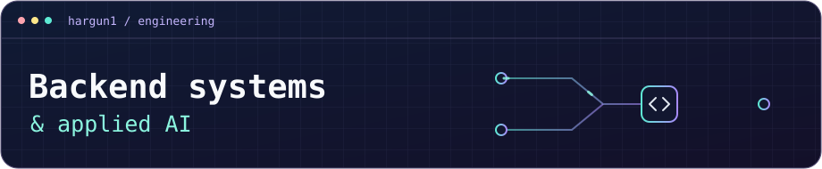

<h1 align="center">Hargun Madan</h1>

B.Tech in AI &amp; ML at MSRIT · Class of 2028 · Bengaluru, India

I build web apps where the backend has to keep state consistent, whether several people are editing the same document or two customers are trying to book the same seat. I also build LLM and computer vision features that people can try through a web interface.

**CodeRIT Core Member** · **Open to 2027 Software Engineering Internships**

## Featured projects

| Project | What I built |
| :--- | :--- |
| **Collaborative Code Editor** | A browser editor with simultaneous editing, live cursors, role-based sharing, and revision restore. Yjs merges concurrent edits, Redis syncs changes across servers, and PostgreSQL stores document state. |
| **SeatLedger** | A ticket booking app that uses PostgreSQL transactions to prevent double booking. It supports expiring seat holds, retry-safe simulated payments, and QR ticket check-in. |
| **TrustLayer** | A JavaScript SDK and dashboard for LLM applications. It applies project policies before generation, validates outputs, and runs dataset evaluations in background jobs. |
| **[PranexusAI](https://github.com/Hargun1/Build-for-bangalore)** | A wellness app with daily health logs and a chat interface that cites retrieved sources and can switch LLM providers when one fails. |
| **[EdgeInspect](https://github.com/Hargun1/insiso-edgeinspect)** | A visual inspection app for metal nut defects. The repo includes a YOLO model exported to ONNX, CPU benchmarks, and an analysis of missed detections. |
| **[Surgical Instrument Detection](https://github.com/Hargun1/AIML-health-project-deployed)** | A browser prototype that detects instruments in uploaded video. It uses Roboflow for detection and TensorFlow.js as a fallback. |

[Browse all public repositories](https://github.com/Hargun1?tab=repositories)

## Tech stack

     

I also work with Java, Python, SQL, Express, REST APIs, WebSockets, and MongoDB.
